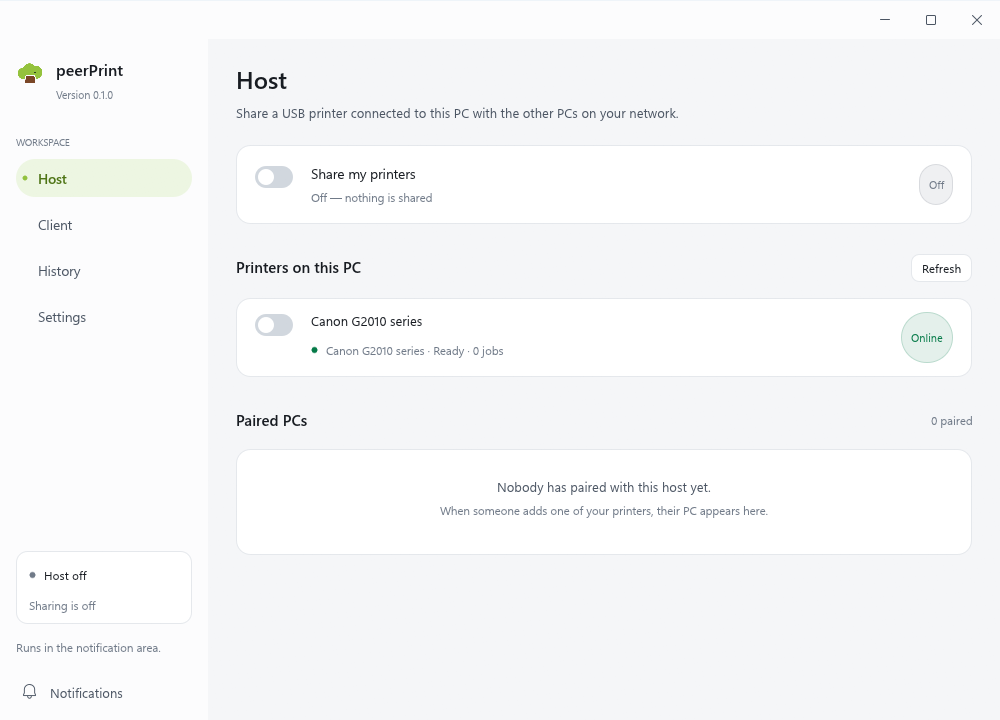

# peerPrint

**Share a USB printer with every Windows PC on your Wi-Fi — without SMB, workgroups, or Windows account credentials.**

peerPrint is a single Windows desktop app. The PC with the printer **hosts** it; every other PC gets an ordinary Windows print queue and prints from any application, as if the printer were plugged in locally.



## Download

Grab the latest installer from the
[Releases page](https://github.com/november-saiful/peerPrint/releases/latest). The setup asks for
the install mode and what this PC should do:

- **All users** — installs to Program Files and registers the background Windows service, so
  sharing works before anyone signs in. Needs administrator approval.
- **Just me** — per-user tray app that starts at sign-in. No admin rights.

Verify the download against `SHA256SUMS.txt`:

```powershell
Get-FileHash .\peerPrint-0.1.0-setup.exe -Algorithm SHA256
```

Windows SmartScreen will warn that the publisher is unknown until signed builds ship; peerPrint
participates in the SignPath Foundation's open-source code signing program. The app has no
telemetry — see [docs/PRIVACY.md](docs/PRIVACY.md).

## Why peerPrint

Built-in Windows printer sharing works, until it doesn't: guest accounts, SMB versions, workgroup
names, discovery across subnets, and a shared PC that has to stay signed in. peerPrint replaces that
stack with one small Rust application and a direct, authenticated TLS connection between the two
PCs. Nothing is exposed beyond the LAN, no Windows account is created, and no printer is opened to
the internet.

## Features

- **Real Windows print queues on clients.** Any application prints normally; peerPrint supplies the
  local TCP/IP port and relay behind the queue.
- **Driver-rendered output.** The client's own printer driver renders the document and peerPrint
  relays the resulting RAW spool bytes, so quality and layout come from the client driver.
- **Automatic discovery.** Hosts announce themselves on the LAN with mDNS; if discovery is blocked
  (AP isolation, VPN), add a host by `IP:port` instead.
- **PIN pairing, trust on first use.** A short PIN pairs the client with the host, and the client
  pins the host certificate's SHA-256 fingerprint.
- **TLS with per-client tokens.** The host stores only token hashes; the PIN and tokens are
  DPAPI-protected on disk.
- **Offline-tolerant client outbox.** Jobs are buffered on disk while the host is unreachable and
  delivered when it returns.
- **Job history.** Accepted → Printing → Printed / Failed for both directions, with All / Sent /
  Received filters.
- **Notification area app.** Closing the window keeps printing alive; the tray menu reopens the
  window or quits. A flyout plus notification center reports pairing, print and failure events.
- **Two install modes.** *Just me* runs a self-contained tray app with no admin rights; *All users*
  installs a Windows service that starts before sign-in and serves printers machine-wide.
- **Guardrails instead of guesses.** The Windows Firewall rules helper, protected-print-mode
  detection, a diagnostics panel and `--diagnose` JSON make failures explainable.
- **Update notices.** peerPrint checks GitHub Releases once a day and links to the new version from
  Settings → Updates. The check can be turned off and never downloads or runs anything by itself.

## How it works

```text
Any Windows app
  → client Windows spooler
  → local TCP/IP port 127.0.0.1:391xx (SNMP off, BIDI off)
  → peerPrint client relay (job buffered to disk)
  → TLS over Wi-Fi with a per-client token
  → peerPrint host
  → host Windows spooler (RAW)
  → USB printer
```

The client spooler and driver produce the print stream exactly as they would for a USB printer;
peerPrint only moves those bytes across the network, and the host submits them to its own spooler
for the shared queue. [docs/print-path.md](docs/print-path.md) records the measured print path,
including what a vendor driver actually sends to the port.

## Requirements

- Windows 10 or 11, x64.
- The **same printer driver** installed on the client as on the host. peerPrint does not transfer
  drivers.
- No administrator rights to run peerPrint itself. One UAC prompt is needed per installed client
  queue, for firewall rules, or for an all-users install.
- PCs on the same local network, with the host reachable on TCP 39100 (configurable).
- Windows protected print mode (Windows 11 24H2+) blocks third-party v3 drivers. peerPrint detects
  it and explains the block in Settings → Diagnostics.

## Build from source

Prefer to build it yourself? The toolchain is pinned by `rust-toolchain.toml`:

```powershell
rustup show          # uses rust-toolchain.toml
cargo build --release
```

The MSVC toolchain is required: Visual Studio Build Tools with the C++ workload and a Windows SDK.
The binary is `target\release\peerprint.exe` with the logo, version information and a per-monitor
DPI manifest embedded.

To build the setup program, install [Inno Setup 6](https://jrsoftware.org/isinfo.php) and run:

```powershell
iscc installer\peerprint.iss
```

The installer asks whether peerPrint is for **all users** (Program Files + Windows service) or
**just me** (per-user tray app), then whether this PC is a host, a client, or both.

## Quick start

### Set up the host

1. Open **Host** and tick **Share my printers**.
2. Select the USB printers to share and set the name clients see.
3. Optionally require a PIN (4–12 digits) for pairing.
4. Add firewall rules (one UAC prompt) so other PCs can connect on TCP 39100.

Only real USB queues are listed (ports starting with `USB`, not PDF/XPS/OneNote virtual printers).
Paired PCs appear with their last-seen time and can be revoked immediately.

### Set up a client

1. Open **Client**. Hosts on the LAN appear automatically via mDNS
   (`_peerprint._tcp.local.`).
2. If discovery is blocked, use **Add by IP:port**.
3. Enter the host PIN to pair. The client pins the host certificate.
4. Install the printer. One UAC prompt creates the local TCP/IP port and Windows queue, with
   bidirectional support off, and starts the relay.
5. Print normally. Jobs queue on disk while the host is unreachable.

The queue uses the host printer name; a ` (peerPrint)` suffix is added when a local queue with that
name already exists. Removing the printer from peerPrint removes the queue, its port and the relay.

## Command line

```text
peerprint.exe                 open the UI (or raise the running instance)
peerprint.exe --autostart     start hidden in the notification area (login entry)
peerprint.exe --background    run headless until Ctrl+C (service-style)
peerprint.exe --diagnose      print a JSON diagnostics report and exit
peerprint.exe --quit          ask the running instance to quit gracefully
peerprint.exe --uninstall-all remove queues, ports, startup entry and settings
peerprint.exe --verbose       verbose logging
```

A single instance owns the app. Starting it again while it runs raises the existing window through
a local named pipe; a `state\status.json` snapshot lets other tools observe the background owner.
Elevation helpers used by the installer and the queue setup are hidden from `--help`.

## What peerPrint stores

Per-user installs keep state in `%LOCALAPPDATA%\PeerPrint\`; all-users installs keep engine state in
`%ProgramData%\peerPrint\` (the tray UI's own logs stay in the user profile):

```text
config.json                  settings (no plaintext secrets)
paired_clients.json          token hashes only
identity\                    host TLS certificate and DPAPI-protected key
outbox\<printer>\            queued client jobs
jobs.jsonl                   job history (rotated by size)
state\status.json            live snapshot for background/UI observability
logs\                        redacted tracing logs
```

`PEERPRINT_DATA_DIR` overrides the directory for development and testing.

## Ports and firewall

| Traffic | Port |
| --- | --- |
| Client → host job transfer (TLS) | TCP 39100 (configurable) |
| Client relays on this PC | TCP 39101 and up (configurable base) |
| Host discovery | mDNS, UDP 5353 |

The host needs inbound rules for TCP 39100 on private networks; the Settings screen can add them
with one UAC prompt. Clients only connect outward and open loopback ports.

## Security

- The host presents a self-signed P-256 certificate generated on first run; clients pin its SHA-256
  after pairing.
- PIN pairing uses SPAKE2 bound to the TLS exporter, so an mDNS-spoofing MITM cannot harvest the
  PIN or splice transcripts.
- Each paired client gets a 32-byte token. The host stores only `SHA-256(token || client_id)`;
  tokens and the PIN are DPAPI-protected on disk.
- Five wrong PINs trigger a one-minute lockout, escalating to one hour.
- Host certificates and keys never leave the host; logs redact PINs, tokens and keys, and frame
  payloads are never logged.

peerPrint is designed for trusted home and small-office LANs. Do not forward its port from the
internet; if you need printing across sites, use a VPN.

## Updates

peerPrint checks the public GitHub Releases feed at most once a day and tells you when a newer
stable release exists. The check sends only the app version in its User-Agent, compares versions,
and opens the release page in your browser when you click **View release** — it never downloads or
runs an installer on its own. Turn it off in Settings → Updates.

Published releases are built by GitHub Actions: the workflow verifies that the tag matches
`Cargo.toml`, builds the release binary, packages the Inno Setup installer, and publishes the setup
plus `SHA256SUMS.txt`. See [CHANGELOG.md](CHANGELOG.md) for release notes.

## Repository layout

```text
src/main.rs        entry point, CLI and process wiring
src/backend.rs     engine/UI split: in-process engine or named-pipe client
src/service.rs     host jobs, pairing requests, notices, outbox wiring
src/host.rs        host engine: accepts clients, authenticates, submits RAW jobs
src/client.rs      client relays, queue state, durable outbox
src/discovery.rs   mDNS advertisement and browsing
src/pairing.rs     SPAKE2 pairing and PIN rate limiting
src/identity.rs    P-256 certificate and DPAPI-protected key
src/net/           framing, protocol messages, TLS configuration
src/win/           spooler, queue install, service, firewall, DPAPI, autostart, single instance
src/ui/            egui UI: host, client, history, settings, dialogs, notifications, tray
src/update.rs      GitHub Releases update check
docs/print-path.md measured Windows print-path notes
installer/         Inno Setup 6 script
```

## Limitations

- The Windows queue reports a job as sent when the local socket closes, not when paper comes out.
  peerPrint job history (Accepted → Printing → Printed / Failed) is authoritative.
- The client needs the printer's Windows driver. If it is missing, the install stops and offers the
  driver picker instead of silently substituting a text-only driver.
- A vendor language monitor may transform spool bytes; see [docs/print-path.md](docs/print-path.md).
- The relay must be running for queues to drain. It starts with Windows, pauses the queues on
  graceful exit and resumes them on start.
- Windows only. The printer connection is USB; network printers are not the target.

## Troubleshooting

- **A host is not discovered.** Check both PCs are on the same private network and that mDNS
  (UDP 5353) is not blocked; add the host with **Add by IP:port** as a fallback.
- **Pairing fails.** Confirm the PIN on the host, and remember five wrong attempts lock pairing for
  a minute.
- **Client install stops at the driver step.** Install the same driver as the host, then retry.
- **Printing stays queued.** Open peerPrint on the client and check the host is online; queued jobs
  drain automatically when it returns.
- **Two-sided printing prints one side per sheet.** A queue created by an older peerPrint build uses
  Windows' default `winprint` processor, which cannot run the driver's manual-duplex flip prompt.
  Open **Client** and click **Repair queue** next to the printer; no re-pairing is needed.
- **Everything looks wrong.** Run `peerprint.exe --diagnose` and check Settings → Diagnostics,
  including the protected-print-mode status.

## Tests

```powershell
cargo test
```

Covers framing round-trips, protocol compatibility, SPAKE2 pairing, install-spec validation, queue
name sanitization, outbox recovery and log redaction.

## License

MIT — see [LICENSE](LICENSE).
